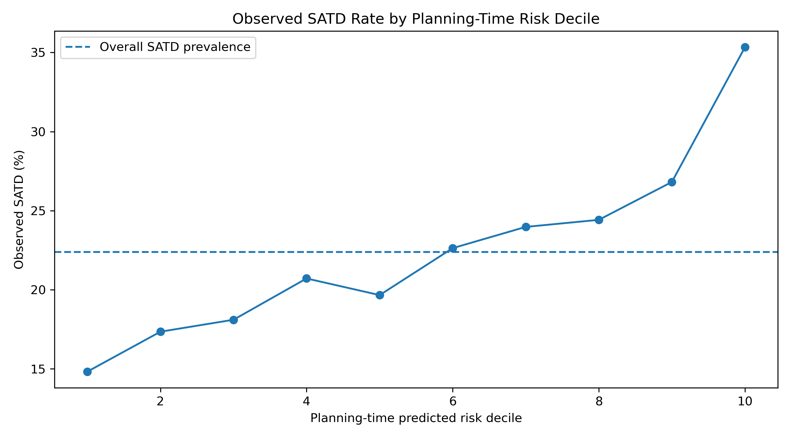
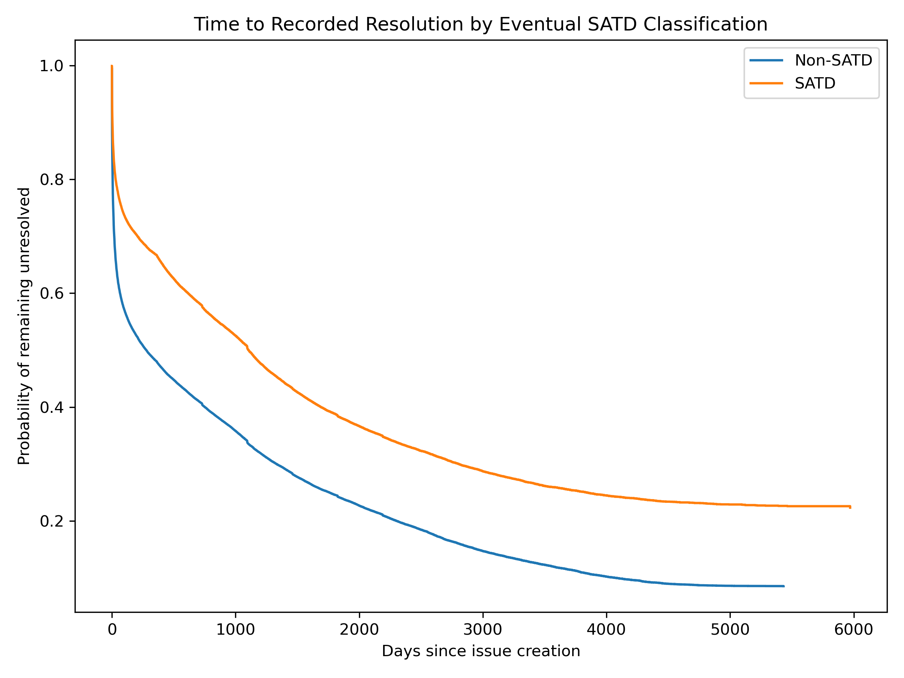
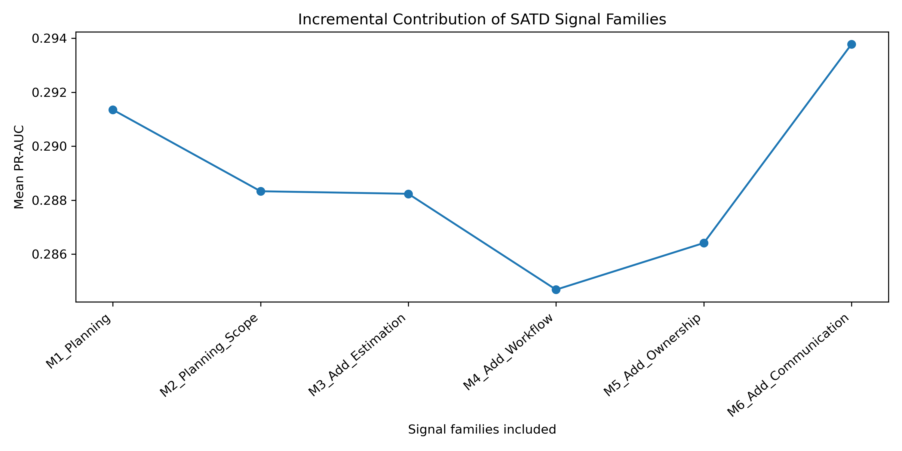
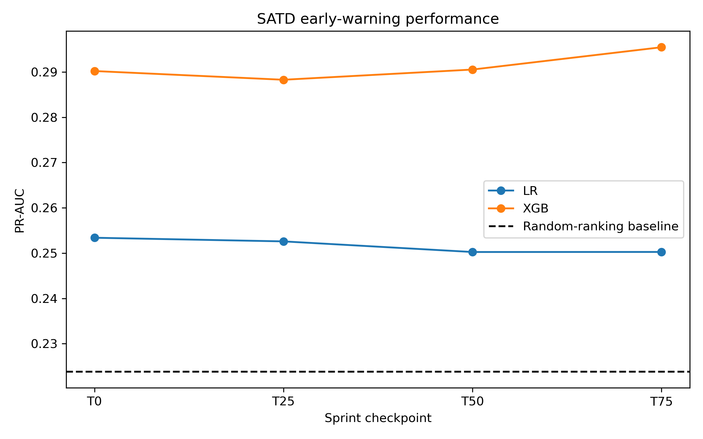

# An Empirical Study of Self-Admitted Technical Debt in Agile Software Environments

This repository contains the datasets, SQL pipeline, analysis notebooks, and empirical results for a study of **Self-Admitted Technical Debt (SATD)** in Agile issue-tracking environments.

The study investigates whether information recorded during sprint planning and execution can identify issues that eventually exhibit SATD. It extends SATD research beyond textual detection by connecting debt admissions with planning context, issue-lifecycle events, workflow changes, ownership changes, estimation revisions, and communication activity.

## Research motivation

Agile teams frequently make short-term implementation compromises to meet delivery goals. Some of these compromises are explicitly acknowledged in issue titles or descriptions and become SATD. Although prior work has made substantial progress in detecting SATD from text, teams still need to know:

- whether SATD-prone issues can be recognized during sprint planning;
- how SATD and non-SATD issues evolve differently;
- which development-process signals generalize across projects; and
- whether those signals become useful early enough for intervention.

Answering these questions can support risk-based issue review, sprint monitoring, and technical-debt management without treating an automated prediction as a replacement for engineering judgment.

## Research goals

| Research question | Goal |
|---|---|
| **RQ1** | Determine whether sprint-planning information can identify issues at elevated risk of eventual SATD. |
| **RQ2** | Compare the lifecycle evolution of SATD and non-SATD issues across scope, estimation, workflow, ownership, and duration. |
| **RQ3** | Identify the planning and in-sprint signal families that provide the strongest and most consistent cross-project evidence of SATD risk. |
| **RQ4** | Determine how early accumulated sprint signals provide a reliable and practically useful warning of eventual SATD. |

## Study design

The analysis uses issue and change-history data derived from the **TAWOS** Agile open-source dataset. SATD labels were generated from issue titles and descriptions using a hierarchical text-classification process. Mutable planning attributes were reconstructed at sprint start to reduce temporal leakage.

The analytical workflow consists of four stages:

1. Reconstruct sprint-start issue attributes and sprint context.
2. Extract scope, estimation, workflow, ownership, and communication signals from issue histories.
3. Compare SATD and non-SATD issues using statistical and survival analyses.
4. Evaluate logistic-regression and XGBoost models using project-aware validation and temporally restricted sprint checkpoints.

The principal planning-time cohort contains **9,507 issues from 25 projects**, including **2,128 SATD issues (22.4%)**.

## Main findings

### RQ1 — Planning-time SATD risk

Issue type and issue age were the clearest planning-time indicators. Documentation issues had substantially higher adjusted SATD odds than technical-work issues, while relative Story Points and sprint workload supplied little independent information.

| Result | Value |
|---|---:|
| Documentation issue adjusted odds ratio | **3.14** |
| Issue-age adjusted odds ratio | **1.22** per SD of log age |
| Logistic-regression mean PR-AUC | **0.260** |
| XGBoost mean PR-AUC | **0.286** |
| XGBoost mean ROC-AUC | **0.580** |
| SATD prevalence in highest-risk decile | **35.3%** |
| Overall SATD prevalence | **22.4%** |

The model is more useful for **risk ranking** than for standalone issue-level classification.

### RQ2 — Lifecycle evolution

SATD issues recorded somewhat more scope, estimation, and ownership activity, but these count differences generally had negligible effect sizes. The strongest broad distinction was temporal: SATD issues remained observable for substantially longer.

| Signal family | SATD median | Non-SATD median | Cliff's delta | Interpretation |
|---|---:|---:|---:|---|
| Scope changes | 1 | 0 | 0.145 | Negligible effect |
| Estimation changes | 0 | 0 | 0.057 | Negligible effect |
| Ownership changes | 2 | 1 | 0.125 | Negligible effect |
| Status transitions | 2 | 2 | 0.057 | Negligible effect |

The detailed history comparison included **3,662 issues**, of which **468 were SATD**, from three projects. The broader duration analysis included **202,213 issues from 25 projects**.

| Time-to-resolution result | SATD | Non-SATD |
|---|---:|---:|
| Kaplan–Meier median | **1,105.2 days** | **278.5 days** |
| Issues with a recorded resolution event | **64.8%** | **77.2%** |

### RQ3 — Informative process signals

Planning context was the dominant cross-project signal family. Communication activity provided the clearest incremental contribution, whereas scope, estimation, ownership, and workflow variables did not consistently improve prediction after the other features were available.

| Removed signal family | PR-AUC without family | Change from full model |
|---|---:|---:|
| Planning | 0.219 | **−0.075** |
| Communication | 0.286 | **−0.007** |
| Workflow | 0.292 | **−0.002** |
| Ownership | 0.294 | +0.0003 |
| Estimation | 0.295 | +0.0007 |
| Scope | 0.296 | +0.0025 |

The full XGBoost model achieved a mean PR-AUC of **0.294**. No individual dynamic signal was simultaneously strong in adjusted association, predictive importance, and consistency across projects.

### RQ4 — Temporal early warning

Predictive performance changed very little as sprint events accumulated. Only the change from T50 to T75 showed a clear positive PR-AUC difference, and the absolute gain was small when only 25% of the sprint remained.

| Checkpoint | Sprint remaining | XGBoost PR-AUC | ROC-AUC | Precision at 20% review budget |
|---|---:|---:|---:|---:|
| T0 | 100% | 0.290 | 0.582 | 0.294 |
| T25 | 75% | 0.288 | 0.581 | 0.296 |
| T50 | 50% | 0.291 | 0.585 | 0.301 |
| T75 | 25% | 0.295 | 0.587 | 0.300 |

No checkpoint satisfied the predeclared 20% alert-budget actionability rule. The evidence therefore does not identify a practically decisive early-warning point.

## Overall conclusion

The results consistently distinguish **prioritization support** from **reliable automated classification**:

- Planning-time information identifies groups with elevated SATD prevalence.
- SATD issues remain unresolved or observable for longer than non-SATD issues.
- Planning features dominate cross-project prediction, with modest incremental value from communication signals.
- Accumulated in-sprint information produces only small late-stage improvements.

These findings support a **human-in-the-loop** workflow in which model scores guide technical review and prioritization. They do not support using the model as an autonomous SATD classifier or universal warning system.

## Repository structure

| Path | Description |
|---|---|
| [`Script.sql`](Script.sql) | PostgreSQL extraction, integration, historical reconstruction, and feature-engineering pipeline. |
| [`Dataset/`](Dataset/) | RQ-specific analytical datasets produced by the SQL/data-preparation workflow. |
| [`NoteBook/`](NoteBook/) | Jupyter notebooks for RQ1–RQ4 statistical analysis, modeling, and visualization. |
| [`rq1_results/`](rq1_results/) | Planning-time statistics, predictive evaluation, calibration, and risk-ranking outputs. |
| [`rq2_results/`](rq2_results/) | Lifecycle comparisons, transition analysis, duration models, and survival outputs. |
| [`rq3_results/`](rq3_results/) | Signal-family models, ablation analysis, importance, and cross-project consistency outputs. |
| [`rq4_results/`](rq4_results/) | Temporal checkpoint models, bootstrap comparisons, calibration, and actionability outputs. |

## Reproducing the analysis

1. Prepare a PostgreSQL database containing the required TAWOS issue, sprint, project, comment, and change-history relations.
2. Run [`Script.sql`](Script.sql) to reconstruct planning-time states and generate the analytical datasets.
3. Open the notebooks in [`NoteBook/`](NoteBook/) in research-question order:
   - `RQ1.ipynb`
   - `RQ2.ipynb`
   - `RQ3.ipynb`
   - `RQ4.ipynb`
4. Execute each notebook from top to bottom to reproduce the statistical tables, model evaluations, and figures in the corresponding result folder.

The committed `Dataset/` directory can be used to reproduce the notebook analyses without repeating database extraction, subject to compatible Python package versions.

